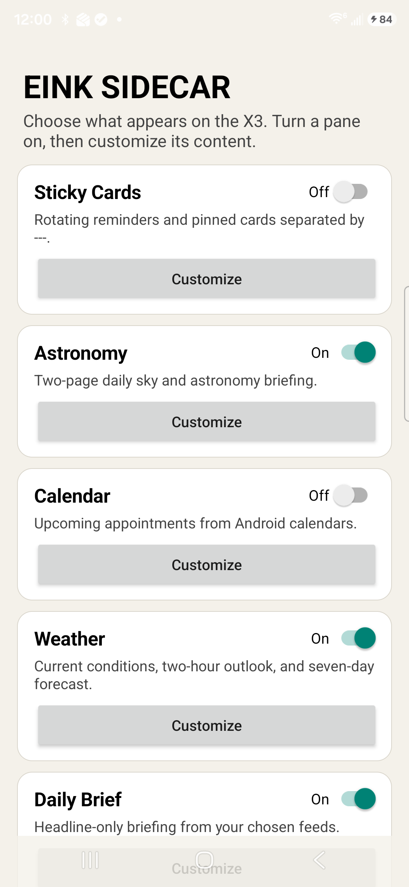
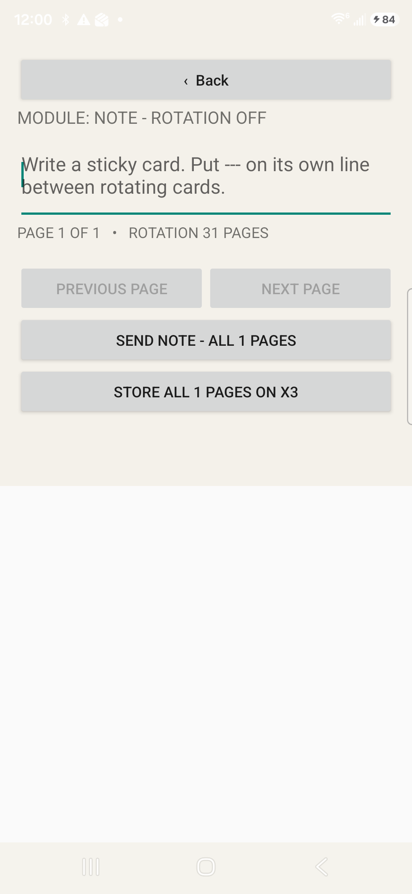

# Eink X3 Android Sidecar

An experimental Android-to-Xteink X3 information display. The phone renders modular pages and sends
compressed, independently replaceable collections over Bluetooth Low Energy. The X3 keeps paging the
last published collection set while a replacement is transferred, verifies each page, and publishes a
new collection only after the complete update is durable.

> [!WARNING]
> This is unofficial experimental firmware for the ESP32-C3 Xteink X3. It is not supported by Xteink
> or the CrossPoint Reader project. Flashing custom firmware can make a device unusable, especially a
> USB-locked or re-locked device. Use it only on an X3 for which you have already confirmed a working
> custom-flash and recovery path. Read [Installation and recovery](docs/INSTALL.md) before downloading.

## What was proven on hardware

- One-, two-, four-, six- and larger multi-page collection updates on a physical X3.
- Raw 1-bpp, bounded monochrome PNG, and raw-DEFLATE page encodings.
- About 50:1 compression on representative text pages: 52,272 raw bytes became roughly 1 KB.
- Interrupted transfers resume from the missing page while the old published rotation remains visible.
- Atomic collection publication after byte count, decoded CRC, persisted-file CRC, and session checks.
- More than the former 16-page total: 11 collections and 24 rotating pages were exercised together.
- Local page rotation continues without retransmitting unchanged pages from the phone.
- A phone-side dashboard with independent On/Off and Customize controls for every pane.

Detailed transaction evidence is preserved in [Hardware proof](docs/HARDWARE_PROOF.md).

## Included panes

- Weather: current conditions, short outlook and seven-day forecast
- Daily Brief, local news and sports headlines
- College football, AP Top 25 plus Florida, NFL and QB/RB/WR leaders when ESPN supplies them
- Stocks plus configurable market, currency and commodity symbols
- Astronomy briefing
- Recent email notification summaries
- Calendar, travel/flight status and package-delivery notifications
- Sticky cards, tasks, grocery lists and fixed recipe displays

Each pane is optional. Flight status requires the user's own Aviationstack key. Email and package
panes read only notifications the user explicitly grants Android permission to expose.

## Android interface

The app requires Android 14 or newer (`minSdk 34`) and a BLE-capable phone.

## Start here

1. Read [Installation and recovery](docs/INSTALL.md).
2. Download `sidecar-debug.apk`, `firmware.bin`, and `SHA256SUMS.txt` from the latest release.
3. Verify both binary hashes before installing or flashing.
4. Flash only after confirming that official CrossPoint firmware can be restored on the same X3.

## Repository layout

- `android/` — sanitized, buildable Android source at tested commit `f3f8dbd`
- `firmware/crosspoint-sidecar.patch` — firmware patch against CrossPoint `eea75d56`
- `firmware/freeink-sdk/freeink-sidecar.patch` — required SDK patch against FreeInk `ae68356`
- `firmware/source-delta/` and `firmware/freeink-sdk/source-delta/` — reviewable changed files
- `firmware/SOURCE_VERSIONS.txt` — exact source revisions
- `docs/` — installation, recovery, architecture, privacy and hardware evidence

Build instructions are in [Building from source](docs/BUILDING.md).

## Project status

This is a hardware-proven experimental release, not a consumer-ready product. The primary test pair
was one Samsung Android phone and one Xteink X3. BLE behavior, battery life, sleep behavior and panel
refresh timing should be treated as needing confirmation on additional devices.

## Credits and license

The device work is derived from [CrossPoint Reader](https://github.com/crosspoint-reader/crosspoint-reader)
and [FreeInk SDK](https://github.com/Free-Ink/freeink-sdk), both under their included MIT licenses.
The Android app bundles Atkinson Hyperlegible Next under the SIL Open Font License. Original Sidecar
code and documentation in this snapshot are released under the [MIT License](LICENSE).
